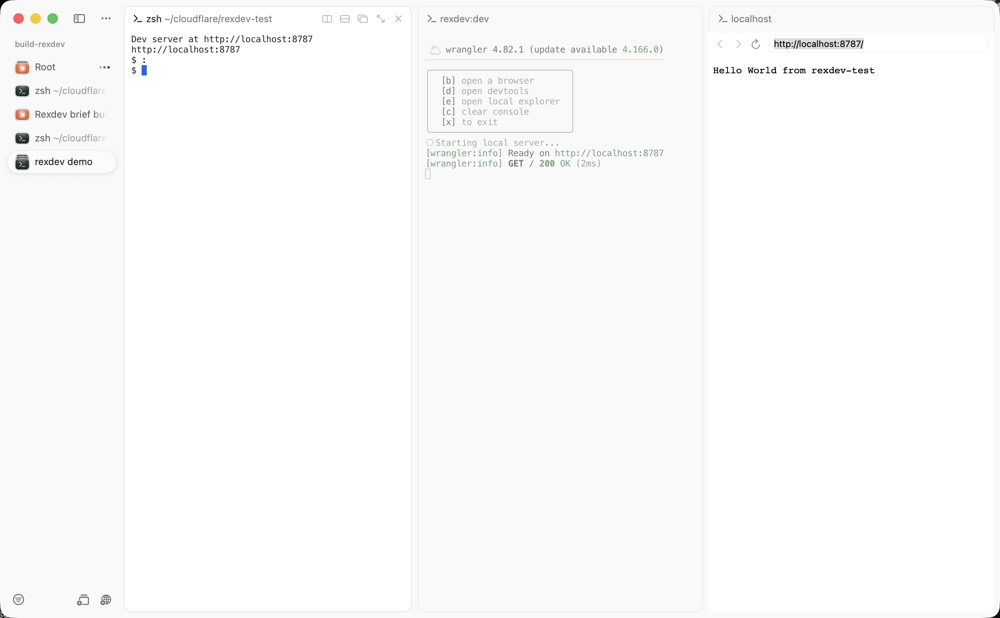
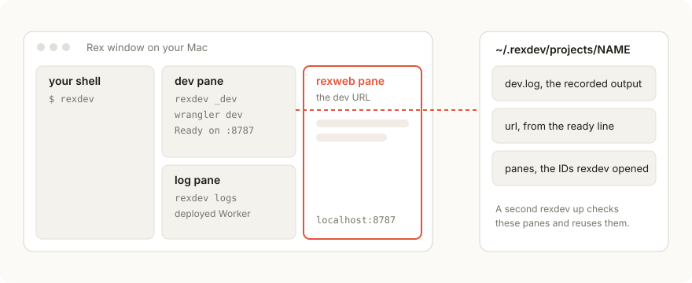

# rexdev

The Cloudflare Workers dev loop for [Rex](https://www.superlogical.com/rex).
Run `rexdev` in a Worker project. `wrangler dev` runs in a pane, your app
opens in a browser pane, and the deployed Worker's logs open in a third. They
sit beside your shell.



[Watch the demo](docs/demo.mp4) (32 seconds). An agent edits a Worker, runs `rexdev restart`, and checks the preview, while the log pane tails the deployed Worker.

```sh
rexdev                  # wrangler dev, a preview, and logs, beside you
rexdev restart          # restart wrangler dev and reload the preview
rexdev open /admin      # preview a path
rexdev deploy           # wrangler deploy, after you confirm
rexdev down             # close the panes and stop wrangler dev
```

## Install

You need:

- macOS with [Rex](https://www.superlogical.com/rex/docs/installation) and a working `rex` command.
- [rexweb](https://github.com/acoyfellow/rexweb), for the preview and `rexdev dash`.
- `jq` and `node`.
- [wrangler](https://developers.cloudflare.com/workers/wrangler/). rexdev uses `node_modules/.bin/wrangler` in your project, or `wrangler` on your PATH.

```sh
git clone https://github.com/acoyfellow/rexdev
cd rexdev && ./install.sh
```

The script asks no questions. You can run it again after you update. Each run
does these steps, and skips the ones that are done:

1. It links the `rexdev` command into `~/.local/bin`.
2. It adds `require("rexdev").setup{}` to Rex's `init.lua`. If `rex config check` fails, it restores the backup.
3. It runs `rexdev doctor`.

## Use it

Run `rexdev` in a Rex pane, in a folder with a `wrangler.jsonc`,
`wrangler.json`, or `wrangler.toml`. It looks in parent folders too.

Press **`Shift-Cmd-D`** in Rex, or pick **Workers: Start Dev Loop** from the
command palette. The other actions are in the palette too.

| Command | What it does |
| --- | --- |
| `rexdev` / `rexdev up` | Open the dev pane, the preview, and the log pane. A second run reuses the open panes. |
| `rexdev down` | Close the panes that rexdev opened, and stop `wrangler dev`. |
| `rexdev restart` | Restart `wrangler dev` in its pane, and reload the preview. |
| `rexdev open [PATH]` | Open the preview at `PATH`, or focus it. |
| `rexdev logs` | A readable tail of the deployed Worker. `--env`, `--status error`, and `--search TEXT` filter it. |
| `rexdev deploy` | Run `wrangler deploy` in a pane, after you confirm. `--yes` skips the question. `--dry-run` uploads nothing. |
| `rexdev dash` | Open the Worker's dashboard page in a browser pane. |
| `rexdev status` | Show the project, the panes, the dev URL, and the wrangler version. |
| `rexdev doctor` | Check that rexdev can work. |

`--config FILE` and `--env ENV` pass through to wrangler. Flags after `--` go
to `wrangler dev`: `rexdev up -- --port 9000 --remote`. `up`, `open`,
`deploy`, `dash`, `status`, and `doctor` take `--json`. `rexdev COMMAND --help`
shows the rest.

### The log pane

`wrangler dev` prints its own logs in the dev pane. The log pane is for the
deployed Worker. rexdev opens it only when the Worker is deployed. Add
`--tail` to open it anyway, or `--no-tail` to skip it.

`rexdev logs` reads `wrangler tail --format json`. It prints one line for each
request, then its `console.log` lines and exceptions:

```
14:02:11  GET    /api/items?limit=10  200  4ms
  log   fetched 10 items
14:02:15  POST   /api/checkout  500  12ms
  error payment failed
  ✘ Error: card declined
```

### Key bindings

Add options to `setup` in Rex's `init.lua`:

```lua
require("rexdev").setup{
  key = "shift+cmd+d",
  restart_key = "shift+cmd+r",
  open_key = "shift+cmd+o",
  deploy_key = false,
}
```

Set a key to `false` for no shortcut. `deploy_key` is off by default. The
deploy action asks before it deploys.

### The dashboard

`rexdev dash` needs your account ID. It reads `account_id` from your wrangler
config, then `CLOUDFLARE_ACCOUNT_ID`, then `wrangler whoami`. If you can reach
more than one account, set `account_id` in the config. The browser pane needs
a Cloudflare sign-in. Import it with `rexweb cookies`.

## Drive it from scripts and agents

```sh
$ rexdev up --json
{"project":"/Users/me/src/api","worker":"api","dev":{"pane":"block:…","url":"http://localhost:8787"},"web":{"pane":"block:…"},"logs":null,"reused":false}
$ rexdev deploy --dry-run --yes
$ rexdev down
```

[AGENTS.md](AGENTS.md) is the guide for coding agents. `rexdev skill` prints it.

## How it works



`rexdev up` splits a pane beside yours. The pane runs a small wrapper around
`wrangler dev`. The wrapper runs wrangler in a terminal that it records. It
watches the record for wrangler's `Ready on` line and saves the URL. When the
line appears, rexdev opens that URL in a rexweb pane.

rexdev saves the pane IDs for each project in `~/.rexdev/projects`. A second
`rexdev up` checks that those panes still exist and reuses them. `restart`
stops wrangler under the wrapper. The wrapper starts it again, in the same
pane.

`rexdev down` stops wrangler and closes only the panes that rexdev opened.

## Troubleshooting

- Run `rexdev doctor`. It prints one `ok` or `FAIL` line for each check.
- **`up` says there is no wrangler config.** Run it in a folder with a `wrangler.jsonc`, `wrangler.json`, or `wrangler.toml`, or give `--config FILE`.
- **The browser pane warns that Rex isn't showing it.** The pane opened, but its Rex window is not on screen. Bring the window forward.
- **The dev pane says wrangler exited.** Press Return in the pane to start it again.
- **There is no log pane.** The Worker is not deployed yet. Deploy it, or run `rexdev up --tail`.
- **`rexdev dash` says you can reach more than one account.** Set `account_id` in your wrangler config.

## Uninstall

```sh
./uninstall.sh            # removes the command and the Rex config line
./uninstall.sh --purge    # also deletes ~/.rexdev
```

## License

MIT. rexdev is a community project. Superlogical does not maintain or endorse
it.
